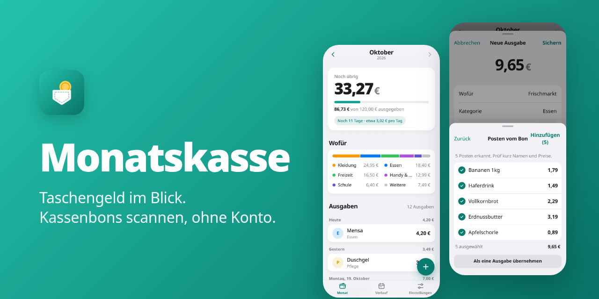
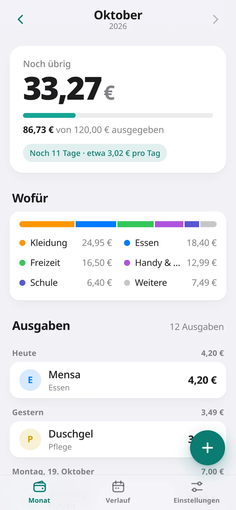
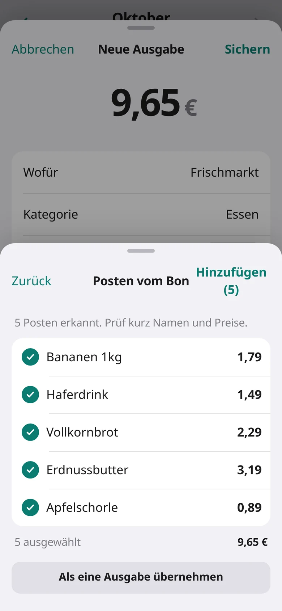
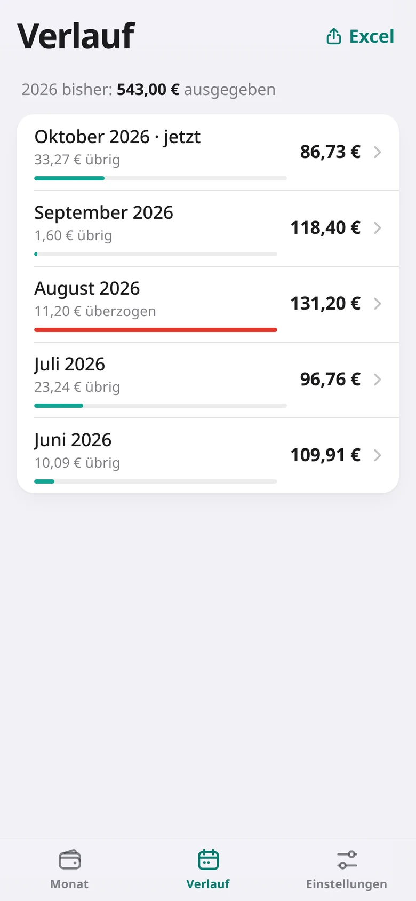
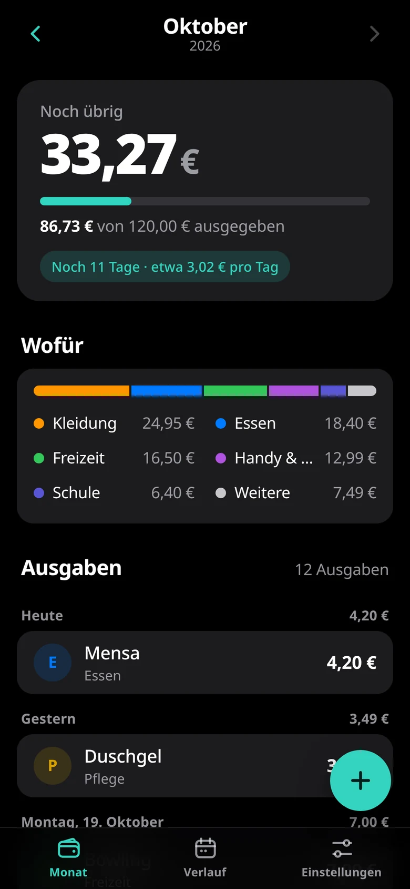

<p align="center"></p>

<h1 align="center">Monatskasse: Taschengeld-App und Haushaltsbuch ohne Konto, mit Kassenbon-Scanner</h1>

<p align="center"><strong>Android-App und Web-App für ein festes Budget pro Monat, etwa Taschengeld oder Budgetgeld. Jede Ausgabe zieht vom Budget ab, Kassenbons fotografierst du, die App liest die Posten heraus. Excel-Export, Backup, kein Konto, keine Bankverbindung, keine Werbung.</strong></p>

<p align="center">
  <a href="https://capacitorjs.com/"></a>
  <br>
  <a href="#installieren"></a>
  <a href="https://brickystudios.github.io/monatskasse/app/"></a>
  <a href="#was-sie-kann"></a>
  <a href="#was-sie-kann"></a>
  <a href="#datenschutz"></a>
  <a href="LICENSE"></a>
  <a href="https://github.com/BrickyStudios/monatskasse/releases/latest"></a>
  <a href="https://github.com/BrickyStudios/monatskasse/commits/main"></a>
</p>

<p align="center">
  <a href="https://github.com/BrickyStudios/monatskasse/releases/latest/download/Monatskasse.apk"></a>
  <a href="https://brickystudios.github.io/monatskasse/app/"></a>
</p>

<p align="center">
  <a href="#installieren">Installieren</a> ·
  <a href="#was-sie-kann">Was sie kann</a> ·
  <a href="#datenschutz">Datenschutz</a> ·
  <a href="https://brickystudios.github.io/monatskasse/taschengeld-tabelle/">Taschengeld-Tabelle 2026</a> ·
  <a href="#selbst-bauen">Selbst bauen</a>
</p>

<p align="center">
  
  
  
  
</p>

## Installieren

**Android 6.0 oder neuer:** [Monatskasse.apk herunterladen](https://github.com/BrickyStudios/monatskasse/releases/latest/download/Monatskasse.apk) (immer die neueste Version), antippen, Installation aus dieser Quelle erlauben. Danach sucht die App beim Start selbst nach neuen Versionen und installiert sie mit einem Tipp. Deine Ausgaben bleiben dabei erhalten.

**iPhone, Rechner und jedes andere Handy:** die [Web-App](https://brickystudios.github.io/monatskasse/app/) im Browser öffnen. Auf dem iPhone in Safari auf Teilen und „Zum Home-Bildschirm“ tippen, dann startet sie wie eine App und läuft auch offline. Die Daten liegen im Browser. Wer die Browserdaten löscht, löscht sie mit, also vorher ein Backup machen.

## Was sie kann

- **Monat auf einen Blick:** wie viel noch übrig ist, wie viel pro Tag noch drin ist, wofür das Geld weg ist. Öffnet immer im aktuellen Monat.
- **Ausgabe eintragen:** Betrag, wofür, Kategorie aus der Schnellauswahl, Datum. Antippen zum Bearbeiten, Löschen lässt sich 5 Sekunden lang rückgängig machen.
- **Kassenbon scannen:** Foto machen, „Posten erkennen“ liest die Zeilen mit Preisen. Summe, Kartenzahlung und Steuerzeilen sortiert die App aus. Abhaken, korrigieren, dann einzeln oder als eine Ausgabe übernehmen.
- **Verlauf:** alle Monate mit Rest oder Überziehung.
- **Excel-Export:** alle Ausgaben plus eine Tabelle pro Monat mit Budget, Ausgaben und Rest, als `.xlsx`.
- **Backup:** alles inklusive Belegfotos in einer Datei. Auf einem neuen Handy lädst du sie wieder.
- **Budget ändern:** gilt ab dem aktuellen Monat, alte Monate rechnen mit ihrem alten Budget weiter.

Bewusst nicht drin: Bankabgleich, Einnahmen-Liste, Sync zwischen Handys. Wie viel Taschengeld in welchem Alter passt, steht in der [Taschengeld-Tabelle 2026](https://brickystudios.github.io/monatskasse/taschengeld-tabelle/) nach der aktuellen Empfehlung des Deutschen Jugendinstituts.

## Datenschutz

Kein Konto, kein Server, keine Analyse. Ausgaben und Belegfotos liegen nur im Speicher der App, die Texterkennung läuft auf dem Gerät. Die Android-App geht nur online, um bei GitHub nach einer neuen Version zu fragen.

## Selbst bauen

Braucht JDK 21, Android SDK (Plattform 35, Build-Tools 35) und Node.

```bash
./build-apk.sh          # -> Monatskasse.apk
npm test                # Geld- und Bon-Parser
python3 tools/build_site.py && cp -r www _site/app   # Website + Web-App nach _site/
```

`build-apk.sh` sucht JDK und SDK unter `~/.jdks/jdk-21.0.13+9` und `~/.bubblewrap/android_sdk`, andere Pfade per `JAVA_HOME=… ANDROID_HOME=… ./build-apk.sh`. Ohne den Release-Schlüssel signiert Gradle mit dem Debug-Schlüssel, und so eine APK kann keine offizielle Version überschreiben. Icon ändern: SVGs in `resources/icon/` bearbeiten, dann `resources/icon/make-icons.sh`.

Ein Tag `v*` baut in GitHub Actions die signierte APK und legt das Release an. Jeder Push auf `main` baut Website und Web-App neu.

## Technik

Vanilla HTML/JS in `www/`, verpackt mit Capacitor 7 (Plugins App, Haptics, Filesystem und Share, alle auf 7.0.x gepinnt). Dieselben Dateien laufen als Web-App mit Service Worker. Texterkennung mit Tesseract.js, selbst gehostet. Excel mit SheetJS. Das Selbst-Update steckt in `android/app/src/main/java/io/github/brickystudios/monatskasse/Updater.java`. Details und Entscheidungen: [`docs/DESIGN.md`](docs/DESIGN.md).

## Lizenz

[GPL-3.0](LICENSE). Tesseract.js und SheetJS stehen unter Apache-2.0, Capacitor unter MIT.
